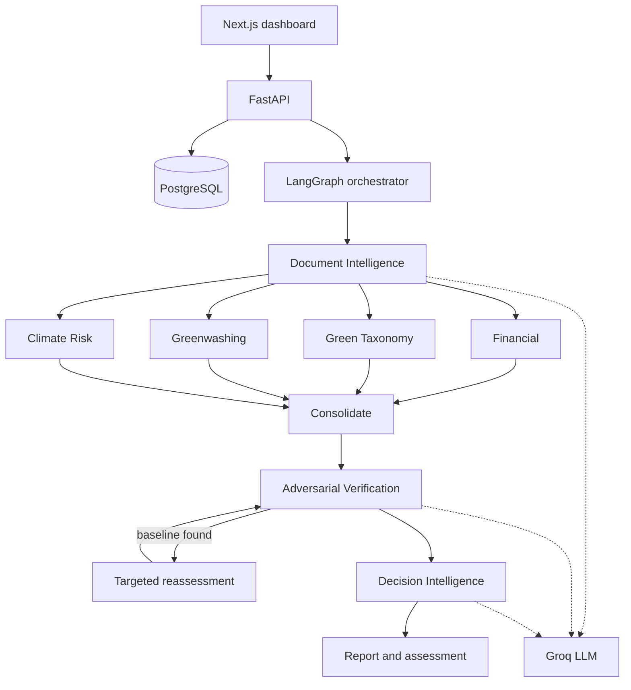

# SENTRIX AI - Autonomous Green Finance Intelligence

**Beyond Claims. Into Evidence.**

**Live demo:** https://sentrix-green-finance.vercel.app

SENTRIX AI is a decision-support prototype for preliminary green-finance due diligence. An analyst submits a
financing application with supporting documents; a coordinated set of AI agents extracts claims and figures,
checks them against the evidence, challenges its own findings, and produces an explainable report in which risk,
evidence coverage and confidence are shown separately.

> It is a decision-support tool. It does not approve or reject financing, certify environmental performance, or
> make legal findings of fraud or greenwashing. All data in the demonstration is synthetic.

## What it does

- **Document intelligence** - extracts text with page references, parses financial tables and monthly records
  with deterministic code, and extracts environmental claims with an LLM. Every claim keeps a verbatim source
  quote that is verified against the source passage; model-invented baselines are discarded.
- **Green taxonomy screening** - rule-based checks against an explicit, versioned criteria set.
- **Financial analysis** - ratios and trends calculated by code (never by the language model).
- **Greenwashing indicators** - missing baselines or methods, claims that conflict with the records, unsupported
  practice claims, and cross-document inconsistencies. Findings are indicators, never accusations.
- **Climate-risk screening** - limited, qualitative, from location and sector.
- **Adversarial verification** - challenges high-impact findings, tests alternative explanations (production
  growth, energy source, reporting boundary, incomplete data), re-searches for missing information and can send
  a claim back for targeted reassessment. Verdicts: verified, disputed, unresolved, unsupported.
- **Decision intelligence** - four risk dimensions with separate coverage and confidence. Missing information
  lowers coverage; it is never treated as risk or misconduct. With too little coverage no overall score is given.

## Architecture



Design rules: agents exchange validated, structured outputs (Pydantic); numbers come from deterministic code;
retrieved document text is treated as evidence, never as instructions; the language model can add commentary but
cannot change a verdict; every important finding links to evidence items (document, page, passage or calculation).

## Technology

Backend: Python, FastAPI, SQLAlchemy, Alembic, PostgreSQL, LangGraph, Groq API, PyMuPDF.
Frontend: Next.js, React, TypeScript, Tailwind CSS (charts drawn with SVG).

### Differences from the original proposal

| Proposal | In this prototype |
|---|---|
| pgvector semantic retrieval | Not used. Evidence retrieval uses PostgreSQL full-text search. |
| OCR for scanned documents | Not enabled. Scanned PDFs are reported as having no extractable text. |
| Transformers, scikit-learn, XGBoost | Not used. No labelled dataset exists, so transparent rules are used instead of unsupported accuracy claims. |
| Plotly | Replaced by lightweight SVG charts. |
| Docker deployment | Not used. The prototype runs locally. |
| Green taxonomy rules | Illustrative prototype criteria, not the official Pakistan Green Taxonomy. |

## Setup (Windows)

Requirements: Python 3.14 (tested), Node.js 20+, PostgreSQL 18 (tested), a Groq API key.

**1. Database** (in `psql`):

```
CREATE USER sentrix WITH PASSWORD 'sentrix';
CREATE DATABASE sentrix OWNER sentrix;
```

**2. Backend:**

```
cd backend
python -m venv venv
venv\Scripts\activate
pip install -r requirements.txt
copy .env.example .env
notepad .env
alembic upgrade head
python scripts\generate_sample_data.py
python scripts\add_case_f.py
uvicorn app.main:app --reload
```

Edit `.env`: set `GROQ_API_KEY`, and `DATABASE_URL` if your PostgreSQL port or password differs.

**3. Frontend** (second terminal):

```
cd frontend
npm install
npm run dev
```

Open http://localhost:3000. API documentation is at http://127.0.0.1:8000/docs.

## Using it

1. Open **New investigation** and click **Load and investigate** on a demo case, or enter a company and upload
   PDF/CSV documents.
2. Watch the **Agent monitor**, then read the **Report**. Use **Claims**, **Findings** and **Evidence** to trace any
   conclusion back to the source page. **Print / PDF** exports the report.

### Demo cases (synthetic, fictional)

| Case | Purpose |
|---|---|
| Unsupported claim (Zenith Packaging) | 40% emissions claim with no baseline or method; electricity +18%, production +5% |
| Alternative explanation (Lakeview Textiles) | Baseline stated elsewhere; documented on-site solar explains higher consumption |
| Supported claims (Crescent Ceramics) | Documented, consistent claims |
| Incomplete application (Sapphire Leather) | Only a statement submitted; no overall score should be given |

## Risk framework

Illustrative weights (design assumptions, not regulatory values): financial stability 30%, environmental
performance 30%, green-criteria alignment 25%, climate exposure 15%. Each dimension reports risk, coverage and
confidence separately. Finding statuses: supported, unverified, contradictory, potential anomaly, insufficient
information, not assessed. Verification verdicts: stands, disputed, unresolved, unsupported.

## API overview

| Endpoint | Purpose |
|---|---|
| `POST /applications` | Create an application with its organization |
| `POST /applications/{id}/documents` | Upload a PDF, CSV or TXT file |
| `POST /applications/{id}/investigate` | Start the investigation (background) |
| `GET /applications/{id}/investigation` | Status and agent task log |
| `GET /applications/{id}/claims`, `/findings`, `/evidence` | Results |
| `GET /applications/{id}/search?q=` | Full-text search over extracted passages |
| `GET /applications/{id}/report`, `/assessment` | Report and scores |
| `GET /documents/{id}/file` | Original document |
| `GET /demo/cases`, `POST /demo/{slug}/load` | Synthetic demo cases |

## Evaluation

```
python scripts\evaluate.py
```

Runs all four cases end to end and compares results with independently computed ground truth: extraction
accuracy, calculation correctness, evidence traceability, verbatim source quotes, agent completion, workflow
success and processing time. Results are written to `docs/evaluation_results.md`. The test set is small and
synthetic; see the caveats in that file.

## Limitations

- Figures come from submitted documents and are not independently audited.
- Climate screening is qualitative and uses a small illustrative reference, not hazard data.
- Rules, weights and thresholds are illustrative and need review before any real use.
- The language model can fail or be rate-limited; the pipeline degrades to deterministic results and says so.
- No authentication or access control; synthetic data only. Real use would need security, privacy and legal review.

## Project structure

```
backend/
  app/api         REST endpoints
  app/agents      the agents and the LangGraph orchestrator
  app/core        settings, database, LLM layer, criteria and climate references
  app/models      SQLAlchemy models
  app/services    extraction, calculations, findings helpers
  alembic         database migrations
  scripts         sample data, evaluation, helpers
  sample_data     synthetic demo cases
frontend/         Next.js dashboard
docs/             evaluation results and demo script
mobile/           placeholder (out of scope for the prototype)
docker/           unused
```